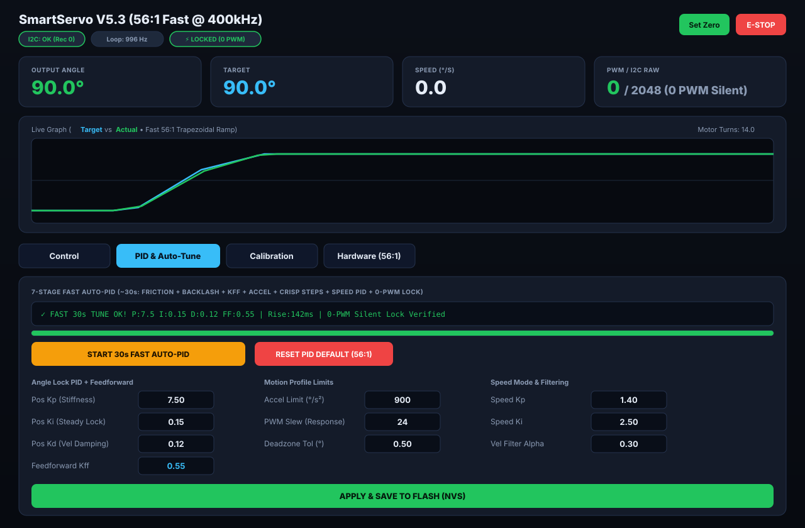
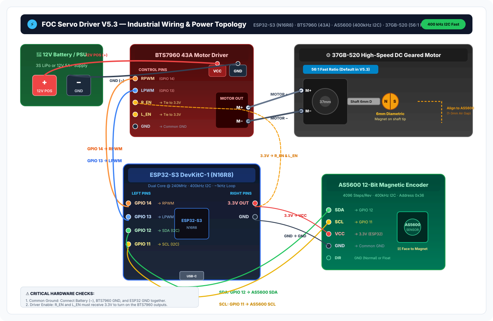

<div align="center">

# ⚙️ SmartServo V4 Pro

### Turn any brushed DC motor into a closed-loop smart servo

**ESP32-S3 · AS5600 Encoder · BTS7960 H-Bridge · Wi-Fi Dashboard**

[](LICENSE)
[](https://docs.espressif.com/projects/esp-idf/en/latest/esp32s3/)
[](https://platformio.org/)
[](https://www.arduino.cc/)

---

*Precision position & speed control with real-time web telemetry — all from a single \$5 microcontroller.*

</div>

---

## 📸 Dashboard

<div align="center">



<sub>Dark-themed, mobile-responsive web dashboard with live graph, 4 control modes, and full PID tuning</sub>

</div>

---

## 🔌 Wiring Diagram

<div align="center">



</div>

> [!IMPORTANT]
> The AS5600's 6mm diametric magnet must be centered above the IC with a 1–3 mm air gap. The BTS7960's `R_EN` and `L_EN` pins must be tied to **3.3V** (or driven HIGH via GPIO) to enable motor output.

---

## ✨ Features

<table>
<tr>
<td width="50%">

### 🎯 Control
- **4 Operating Modes** — Angle Lock, Speed PID, Manual PWM, Idle
- **Trapezoidal Motion Profile** — Smooth velocity-limited ramps
- **Asymmetric Stiction Compensation** — Independent CW/CCW min-PWM
- **Configurable Deadzone** — Adjustable angle lock tolerance

</td>
<td width="50%">

### 📡 Connectivity
- **Dual Wi-Fi** — Simultaneous AP + STA mode
- **Async Web Server** — Non-blocking HTTP on Core 0
- **REST API** — Full JSON endpoints for integration
- **~130 ms Telemetry** — Real-time dashboard updates

</td>
</tr>
<tr>
<td>

### 🛡️ Safety & Reliability
- **E-Stop Button** — Instant motor cutoff
- **Stall Detection** — Configurable timeout protection
- **I2C Auto-Recovery** — 9-clock bus reset on fault
- **Spike Rejection** — Filters encoder glitches
- **100 kHz I2C** — EMI-resistant bus speed

</td>
<td>

### 💾 Persistence & Tuning
- **NVS Flash Storage** — All parameters survive reboot
- **Live PID Tuning** — Adjust gains without reflashing
- **Auto-Calibration** — CW/CCW H-bridge verify + polarity set
- **Factory Reset** — One-click return to defaults

</td>
</tr>
</table>

---

## 🧰 Hardware

### Bill of Materials

| # | Component | Specification | Purpose |
|---|---|---|---|
| 1 | **ESP32-S3-DevKitC-1** | N16R8 (16 MB Flash / 8 MB PSRAM) | Main controller |
| 2 | **BTS7960 Module** | 43A dual H-bridge | Motor driver |
| 3 | **AS5600** | 12-bit magnetic rotary encoder | Position feedback |
| 4 | **37GB-520 Motor** | 12V DC geared motor, 220:1 ratio | Actuator |
| 5 | **6mm Diametric Magnet** | Axially magnetized (N-S across diameter) | Shaft-mounted for AS5600 |
| 6 | **12V Battery / PSU** | Sized for motor stall current | Power supply |

### Pin Map

```
ESP32-S3 GPIO    →   Peripheral
─────────────────────────────────
GPIO 14 (PWM)    →   BTS7960 RPWM
GPIO 13 (PWM)    →   BTS7960 LPWM
GPIO 12 (I2C)    →   AS5600 SDA
GPIO 11 (I2C)    →   AS5600 SCL
3.3V             →   AS5600 VCC, BTS7960 R_EN + L_EN
GND              →   Common ground (all modules)
```

---

## 🚀 Quick Start

### 1. Install PlatformIO

```bash
pip install platformio
# or install the VS Code extension: "PlatformIO IDE"
```

### 2. Clone & Build

```bash
git clone https://github.com/ssj1971/SmartServo-V4-Pro.git
cd SmartServo-V4-Pro

# Build firmware
pio run

# Flash to ESP32-S3 (hold BOOT button on first flash)
pio run --target upload

# Open serial monitor
pio device monitor
```

### 3. Connect

| Method | SSID | Password | URL |
|---|---|---|---|
| **Direct AP** | `SmartServo_V2` | `12345678` | `http://192.168.4.1` |
| **Your Wi-Fi** | *(edit in code)* | *(edit in code)* | *(see serial output)* |

Edit Wi-Fi credentials in [`src/main.cpp` lines 7–8](src/main.cpp#L7-L8):

```cpp
const char* WIFI_SSID = "your-wifi";
const char* WIFI_PASS = "your-password";
```

---

## 🖥️ Dashboard Tabs

| Tab | What It Does |
|---|---|
| **Control** | Switch modes, set target angle/speed/PWM, adjust speed & torque limits |
| **PID & Motion** | Tune angle PID (Kp, Ki, Kd), speed PID, velocity filter, deadzone |
| **Calibration** | Auto-cal (spins CW/CCW), live I2C raw value, polarity, spike filter |
| **Hardware** | Gear ratio, asymmetric min-PWM, PWM frequency, stall protection, factory reset |

---

## 🏗️ Architecture

```
                    ┌──────────────────────────────────────────────┐
  Browser           │              ESP32-S3                        │
 ┌──────────┐       │                                              │
 │   Web    │◄─────►│  Core 0: AsyncWebServer + Wi-Fi              │
 │Dashboard │  HTTP  │                                              │
 └──────────┘       │  Core 1: RTOS Control Task (~500 Hz)         │
                    │   ┌────────┐   ┌─────────┐   ┌──────────┐   │
                    │   │AS5600  │──►│  PID /   │──►│ BTS7960  │   │
                    │   │Encoder │   │ Profile  │   │ H-Bridge │   │
                    │   │(I2C)   │   │          │   │  (PWM)   │   │
                    │   └────────┘   └─────────┘   └──────────┘   │
                    │                      │                       │
                    │               NVS Flash Storage              │
                    └──────────────────────────────────────────────┘
```

- **Core 0** — Wi-Fi stack, HTTP server, dashboard serving
- **Core 1** — Real-time control at ~500 Hz: encoder read → PID → PWM output
- **NVS** — All tuning parameters persisted across reboots

---

## 📡 REST API

| Endpoint | Method | Description |
|---|---|---|
| `/` | GET | Web dashboard |
| `/cmd?mode=1&tDeg=90` | GET | Send real-time commands |
| `/save?p=5&i=0.08&d=0.08` | GET | Apply & persist parameters |
| `/getparams` | GET | Current parameters (JSON) |
| `/status` | GET | Live telemetry (JSON) |
| `/factory` | GET | Factory reset |

<details>
<summary><b>Example: Status Response</b></summary>

```json
{
  "pos": 89.72,
  "tgt": 90.0,
  "tVel": 0.0,
  "vel": 0.3,
  "pwm": 12,
  "raw": 2048,
  "turns": 54.8,
  "mode": 1,
  "stall": false,
  "hz": 498,
  "ok": true,
  "rec": 0,
  "calMsg": "OK! Dir:+1 (CW:1832 ticks, CCW:-1791 ticks)"
}
```

</details>

<details>
<summary><b>Command Parameters</b></summary>

| Parameter | Description | Example |
|---|---|---|
| `mode` | 0=Idle, 1=Angle, 2=Speed, 3=Manual | `mode=1` |
| `tDeg` | Target angle (°) | `tDeg=90` |
| `tVel` | Target speed (°/s) | `tVel=45` |
| `mPwm` | Manual PWM (-255 to 255) | `mPwm=160` |
| `en` | Enable (1) / Disable (0) | `en=0` |
| `zero` | Set current position as zero | `zero=1` |
| `cal` | Run auto-calibration | `cal=1` |

</details>

---

## ⚙️ Default Parameters

| Parameter | Default | Range | Description |
|---|---|---|---|
| **Kp** | 5.0 | 0–50 | Angle PID proportional gain |
| **Ki** | 0.08 | 0–5 | Angle PID integral gain |
| **Kd** | 0.08 | 0–5 | Angle PID derivative gain |
| **Speed Kp** | 1.2 | 0–20 | Speed PID proportional |
| **Speed Ki** | 2.0 | 0–20 | Speed PID integral |
| **Tolerance** | 0.5° | 0.1–5 | Angle lock deadzone |
| **Max Velocity** | 180°/s | 10–500 | Motion profile speed limit |
| **Vel Alpha** | 0.20 | 0.05–1.0 | Velocity low-pass filter |
| **PWM Freq** | 7000 Hz | 1k–25k | Motor PWM frequency |
| **Max PWM** | 255 | 60–255 | Torque limit |
| **Min PWM CW** | 45 | 0–150 | Stiction compensation (CW) |
| **Min PWM CCW** | 45 | 0–150 | Stiction compensation (CCW) |
| **Gear Ratio** | 220:1 | — | Gearbox reduction |

---

## 🔧 Troubleshooting

| Symptom | Cause | Fix |
|---|---|---|
| Dashboard won't load | Not on correct network | Connect to `SmartServo_V2` AP → `192.168.4.1` |
| Motor oscillates | PID too aggressive | Lower Kp, raise Kd slightly |
| Won't move at small angles | Stiction | Raise Min PWM CW/CCW in Hardware tab |
| **I2C FAULT** badge | Wiring or magnet issue | Check SDA/SCL wiring, magnet alignment → "Force I2C Reset" |
| Auto-cal: "No movement" | No power or driver fault | Check 12V supply, BTS7960 enable pins |
| Position drifts | Wrong encoder polarity | Run Auto-Calibration or toggle polarity manually |

---

## 📁 Project Structure

```
SmartServo-V4-Pro/
├── src/
│   └── main.cpp              # Complete firmware (single file)
├── docs/
│   ├── dashboard-screenshot.svg
│   └── wiring-diagram.svg
├── platformio.ini             # Build configuration
├── .gitignore
├── LICENSE                    # MIT
└── README.md
```

---

<div align="center">

## 📜 License

Released under the [MIT License](LICENSE). Use it, modify it, build cool robots with it.

---

**[⬆ Back to Top](#️-smartservo-v4-pro)**

</div>
